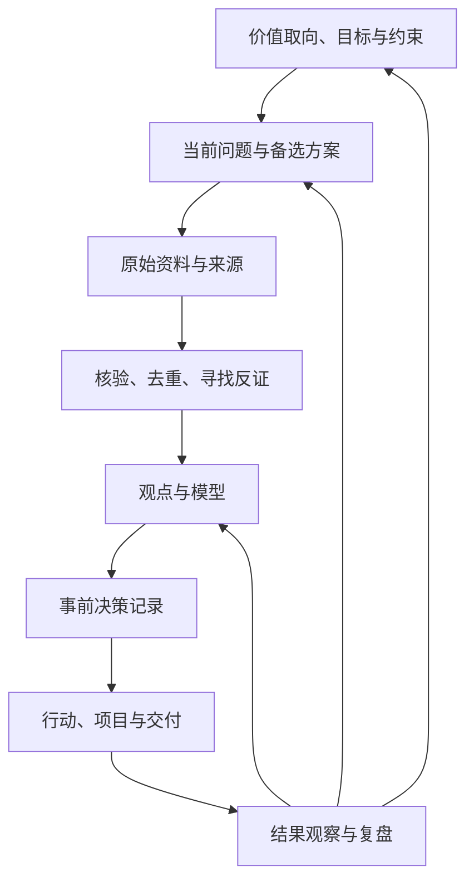

# 个人知识、判断决策与成长系统构建方案

版本：v0.1｜2026-11-05｜适用起点：开始收集 AI 对话，希望同时支持长期学习与实际判断。

进度说明：本文件保留第一轮设计基线。首批6份文档现已完成分类提取，当前状态与审核分工见[本轮说明](04-首批资料分析与审核说明.md)，不再以本文件末尾的初始未完成清单作为最新进度。

## 1. 先确定系统的产出

建议构建一个可以不断纠错的个人系统，核心产出有四种：

- **可追溯的认识**：知道一个观点来自哪里，适用于什么情况，哪些部分仍不确定。
- **可执行的判断**：面对具体问题，能提出选项、权衡代价、划定风险边界并作出选择。
- **可检验的行动**：将认识转为项目、交付或练习，预先写明怎样观察结果。
- **可修订的规则**：结果出现后，能够修改知识、行动策略和系统本身。

资料量、笔记数、图谱节点数可以描述规模，不能单独证明上述产出。现阶段也没有充分依据认定某种公开笔记方法是适用于你的“全局最优解”。应先确定约束，再用实际使用结果选择。

已确认以“通用成长＋投资判断”为两个应用入口。工具与维护方式暂按个人使用、本地优先、中文为主、低维护成本、跨工具可迁移设计；这些工具约束尚未确认为个人偏好。

## 2. 如何把专业人士的做法转成系统机制

以下明确区分原作者观点和本方案的实现建议。文中的 S 编号对应[来源表](03-来源与核验说明.md)。

| 来源 | 本轮可以确认的要点 | 转成个人机制 | 适用边界 |
|---|---|---|---|
| Meadows《Leverage Points》《Dancing With Systems》[S01、S02] | 系统的目标、规则、信息流、反馈与心智模式都是干预对象；模型应接受挑战 | 先写目标；为重要模型写边界、延迟与反证；定期检查系统规则 | 系统思考提供分析语言，不等于能够精确预测复杂现实 |
| 巴菲特 1996 年股东信 [S03] | 投资判断要留在能力圈内，识别边界比圈的大小重要 | 决策记录增加“已知／未知／能力边界”；允许“暂不行动” | 投资原则不能直接证明某项投资正确，也不代表应复制其持仓或集中度 |
| 芒格 1994 年演讲转载记录 [S46] | 孤立事实需要放入模型框架；要使用多个学科的模型 | 为同一重要问题保留替代解释，记录各模型解释什么、遗漏什么 | 本轮使用的是转载演讲稿；不是对每句话与录音逐一校对 |
| Dweck《Mindset》出版社介绍与本人 HBR 文章公开部分 [S25、S06] | 成长型思维是本书主题；本人提醒概念会被误读 | 本方案将成长落实为“行动—反馈—调整策略—再次尝试”，并记录需要的帮助 | 这是设计转译；不声称仅凭心态就能提高表现，不报告未经核对的干预效果 |
| Alavi、Leidner，MIS Quarterly，2001 [S38] | 知识管理系统应支持知识的创造、转移与应用；知识管理需要过程视角 | 原始资料之外，必须有观点、应用与复盘环节 | 本轮核对 DOI、元数据与摘要；不是个人笔记软件效果的比较试验 |
| NIST Baldrige 核心价值 [S08] | 系统视角、组织学习、基于事实的管理 | 同时检查整体目标、实际结果和改进动作 | 组织管理框架迁移到个人场景，属于本方案的设计建议 |
| Andy Matuschak 的公开工作笔记 [S12] | 常青笔记以概念为中心，持续演进，并通过链接建立联系 | 一篇观点笔记表达一个可独立讨论的主张，保留修订历史 | 作者实践可供学习，不是因果效果证据 |
| Tiago Forte 的 PARA 与 CODE [S10、S11] | 按用途组织材料，并经历收集、组织、提炼、表达 | 材料应连接当前问题或长期领域；处理应产生自己的表述或交付物 | 不将其营销表述视为独立研究结论 |
| Farnam Street 决策日志 [S40] | 事前记录选项、依据、预期和概率，随后回看 | 决策时保存原始判断，结果出现后另写复盘 | 是实践方法；不能保证结果更好 |
| 段永平 | 本轮未取得可核对的原始发言正文 | 设置待核验专题，等待原文、访谈视频或可定位文字材料 | 不用网络语录替代证据，也不将本方案建议归到其名下 |

专业人士的成功经历是有价值的线索，但不能自动排除幸存者偏差、时代条件和不可复制资源。应提取他们如何观察、限制错误、分配注意力和更新判断，而不是只收集结论。

## 3. 总体架构：方向、知识、决策、行动、反馈

### 3.1 方向层：决定什么值得知道

写一页“个人系统章程”：重视什么，哪些代价不能接受，当前一年希望改善什么，近期哪个项目最重要。长期方向用于取舍，短期问题用于行动。

例如，“提高投资认知”过于宽泛；“我能否解释某类公司的收入、成本、现金流、竞争变化及主要不确定性”更容易指导资料选择。

不同目标可能冲突：投资收益、时间自由、职业成长和家庭责任并不总能同时最大化。将冲突写出来，不能交给一个不透明的综合分数替你决定。

### 3.2 知识层：分清材料、观点和模型

**原始资料**保存发生过什么、别人说过什么。AI 对话是来源材料，不因表达流畅就成为事实。

**观点笔记**保存自己的主张、理由、证据、适用范围及反证。标题尽量是一句可以讨论的话，如“长期持有仍需要定期检查原投资论点”。

**模型笔记**保存可以重复使用的解释工具，例如反馈回路、机会成本、概率更新、能力圈和安全边际。模型需要适用条件与失败情形，不能只剩一句定义。

**问题地图**组织相关材料：这个问题有哪些解释，哪些证据支持或冲突，下一步需要知道什么。目录解决放在哪里；链接与地图解释为什么相关。

### 3.3 决策层：把认识转为选择

每次重要决定至少回答：

1. 真正的问题是什么？截止时间是什么？
2. 有哪些选项，包括等待、缩小范围或不行动？
3. 各选项的收益、成本、机会成本与不可逆损失是什么？
4. 哪些是事实、推断、预测或价值偏好？
5. 最有力的反对理由是什么？什么新信息会使自己改变主意？
6. 当前选择及承担的风险是什么？何时检查、继续、调整或退出？

低影响、可逆决定只写简版；高影响或难以撤回的决定补充更多证据与替代解释。模板是帮助判断的工具，不应使日常小事也变成文书工作。

### 3.4 行动层：让知识接受现实检验

行动项必须有明确下一步、可观察交付和检查日期。阅读某份报告可以是行动，但“继续学习”本身不是可验收结果。

成长任务宜写成技能问题和交付，例如“用自己的话解释三个财务指标，并检查它们在一份年报中是否一致”，而非“成为更有成长思维的人”。

### 3.5 反馈层：允许更新三个层次

- 执行没有完成：调整时间、任务粒度或资源。
- 执行完成但结果不佳：检查策略、假设、外部条件与观察方式。
- 反复努力仍无价值：重新审视目标、约束和是否值得继续。

复盘必须区分决策过程和实现结果。好结果不必然证明原推理正确；坏结果也不能单独证明当时的选择不合理。先恢复当时可获得的信息，再评价过程。

## 4. 最小数据结构与关系

建议采用“按对象类型放文件，按主题建立地图”的结构，避免为每种分类再复制一份资料。

| 对象 | 必须记录 | 主要关系 |
|---|---|---|
| 来源 SRC | 来源身份、日期、定位、获取方式、原始文件、核验状态 | 证明或反驳某个观点 |
| 观点 CLM | 明确主张、证据、反证、范围、状态 | 来自来源，解释问题，供决策引用 |
| 模型 MOD | 机制、变量、假设、延迟、适用与失效条件 | 解释观点，连接不同主题 |
| 问题 QUE | 问题、重要性、备选解释、缺口、下一步 | 汇总观点、模型与相关决定 |
| 决策 DEC | 事前信息、选项、理由、预测、风险、复查条件 | 引用知识，产生行动 |
| 行动 ACT | 下一步、投入上限、交付、观察标准 | 执行决定，产生结果 |
| 复盘 REV | 当时预期、实际观察、差异原因、规则变更 | 回连原决策，更新知识与目标 |

文件最小公共字段建议为 `id、type、created、status、topics`。有来源的对象补上 `sources`；需复查的对象补上 `review_on`。不要在尚未形成使用习惯时强迫每张笔记填写几十个字段。

关系表达用“支持／反驳／依赖／应用于／取代”这样的语义，加一句解释。相似关键词不一定代表同一概念；同一主题也可能存在相反观点。

## 5. AI 对话文档的入库流程

### 阶段 A：原样收集

保存完整问题与回答，记录平台、对话日期、导出日期、主题，以及可见的模型信息；看不到模型版本就写“未知”。保留标题、页码、时间戳或段落定位。

对话中的用户需求与 AI 建议分别标注。只截取 AI 回答可能丢失约束，造成后来误用。

### 阶段 B：按具体问题拆解

提取与当前问题相关的主张，不要求每份长文都逐段制作笔记。将内容区分为可核查事实、推断、预测、建议、价值偏好和待核实引用。

例如，“某项指标增长”是待核查的事实；“因此竞争优势增强”是推断；“所以应买入”还涉及价格、风险与个人约束。三者不能在摘要中压成一句结论。

### 阶段 C：核验与比较

对影响决定的关键主张寻找原始来源，检查日期、上下文、适用范围与反例。找不到的条目标记“待核验”，不包装成权威结论。

多个 AI 意见一致，只能说明出现了一致表述。它们可能共享来源、复述同一内容，不能直接当成多个独立证据。相同引用、转载与重复导出应归为同一来源链；保留不同表述的出处。

### 阶段 D：形成自己的认识

将可用材料写成简短观点，注明目前接受到什么程度、仍有哪些疑点、适用于哪些情形。处理同主题材料时保留冲突表，不用“综合起来”抹平分歧。

观点状态建议：`待核验 → 暂采纳 → 已修订／已废弃`。来源身份真实、主张有证据、结论可用于当下决定，是三个不同判断，分别记录。

### 阶段 E：进入应用与反馈

至少连接一个问题或实际任务；有必要才进入决策记录。保留纯兴趣资料是允许的，不必强行把每句话转为行动。

已有决策的事前部分保留快照。后续新增信息注明时间，另写复盘；纠正笔误应说明更正内容，不能悄悄把过去的预测改成已知结果。

**入库完成标准**：材料能找回；重要主张有定位与核验状态；清楚它与哪个问题相关。并非所有材料都必须完成一整套加工。

## 6. 把“系统性”落实为可检查机制

### 两类存量与三种反馈

原始资料存量可能持续增长，可用知识却会因失效、遗忘上下文或不再适用而减少。不能把资料增加等同于系统能力增加。

- 正向积累：问题清楚 → 来源更相关 → 观点可用 → 行动与交付 → 获得反馈 → 改进问题与模型。
- 积压循环：无限收集 → 待处理材料增加 → 处理更困难 → 回避使用 → 继续通过收集获得进展感。该循环是本方案的风险假设，应在自己的使用记录中检查。
- 纠偏反馈：维护成本过高 → 减少字段和收集范围、归档低价值内容 → 恢复行动时间。

对每个重要问题增加四个检查点：边界是否漏掉重要因素；结果反馈是否存在延迟；是否把相关关系当成因果；是否只优化了局部指标而损害整体目标。

### 不同内容使用不同复查时钟

企业财务信息、工具功能与项目假设变化较快；来源明确的一般概念通常变化较慢。复查日期取决于变化速度和决策影响，而非所有笔记一律每周重读。

系统应支持三种升级：修正一条观点、改进一套流程、改变一个目标。若只能新增笔记，不能撤回或改动原结论，就缺少成长能力。

## 7. 投资判断与通用成长如何共用底座

### 投资判断入口

依次组织：能力边界 → 生意如何创造价值 → 竞争与管理 → 财务及现金流 → 估值情景 → 风险与反证 → 是否行动 → 后续跟踪。

财务事实优先连接公司公告、年报等原始材料；AI 用于解释、提问和比较，不能替代核对。区分公司经营变化、估值假设变化和市场价格变化。

投资记录应写清最初论点、关键假设、可承受损失与资金约束、什么信息会推翻论点。暂不设置统一买卖阈值、仓位或收益目标；这些需要个人情况和具体问题。本轮不作个股买卖判断。

### 通用成长入口

从真实工作或生活问题出发，选择可练习的具体技能，安排小范围行动，获取反馈，调整方法和资源。把“暂时做不到”进一步拆为知识不足、方法不适、投入不足、资源限制或目标不合理等可检查假设。

不要把所有失败归为不够努力，也不要把所有坚持视为正确。成长可以体现为改方法、求助、缩小范围或结束一个不值得继续的项目。

两个入口共用来源、观点、决策和复盘结构，但各自的风险约束与观察周期不同。不能用一次短期投资盈亏评价全部成长，也不能用“我在学习”掩盖长期失效的判断。

## 8. 衡量系统是否有用

先记录基线，再比较变化。下表是试运行观察项，不是经过研究证明的通用标准。

| 观察项 | 操作方式 | 不能据此推出什么 |
|---|---|---|
| 找回信息的时间 | 给定一个真实问题，记录找到原文和相关观点的耗时 | 快速找到不等于观点正确 |
| 关键依据的可追溯性 | 抽查近期决定，是否能定位关键材料和反对证据 | 引用多不等于证据独立或质量高 |
| 应用情况 | 哪些笔记实际进入了决定、交付或练习 | 不是要求所有阅读都立即产生效益 |
| 到期反馈的完成情况 | 对已有检查日期的决定，记录已观察、延期或无法判定 | 复盘数量不等于复盘质量 |
| 维护成本 | 记录整理、找资料和行动各自花费的时间 | 时间投入越多不一定越好 |
| 规则更新 | 哪个错误被识别，依据是什么，规则如何改变 | 单个案例不能证明普遍有效 |

对于可以明确到期判定的二元事件，可选用 Brier 分数：平均 `(事前概率 p - 实际结果 y)^2`，其中 `y` 为 0 或 1，越小越好 [S20]。预先固定截止日期与判定规则，未到期或无法判定的事件不混入已结算样本。

需要同时比较同一批事件的简单基准预测，并报告样本量；少量结果、不同难度的问题或事后挑选样本，都不能用来证明预测能力提高。概率评分也不衡量偏好是否正确、损失是否可承受，或投资收益是否理想。

## 9. 工具与规模升级路径

**当前建议：本地 Markdown + 一个主要编辑入口；如无既有偏好，可选 Obsidian。** 依据是文件可保存、可阅读、可迁移，适合持续累积；不是对其判断效果的实验证明 [S28]。

第一阶段用文件、链接、目录和模板完成工作。暂不引入复杂知识图谱数据库、多工具双向同步或全库自动摘要。

后续升级由瓶颈触发：

- 反复找不到相同概念：先改标题、别名、问题地图和链接。
- 材料已很多且关键词搜索仍不够：评估语义检索，要求答案回到具体原文定位。
- 需要跨大量记录统计：再增加索引、查询或轻量数据库。
- 需要长期团队协作：再评估在线数据库与权限管理。

向量检索和自动关联能帮助发现材料，不能替代证据核验。核心内容保留在可导出的格式中；同步之外应有独立备份，并实际检查能否恢复。原文含个人或商业敏感信息时，在上传外部服务前按实际需要删减。

## 10. 首个 30 天的实施方案

以下时间和数量仅是可调整的启动安排，没有声称是研究得出的最佳频率。

| 阶段 | 工作 | 验收产出 |
|---|---|---|
| 第 1～3 天 | 确定一个当前问题、目标与投入上限；熟悉模板 | 一页章程、一张问题地图 |
| 第 4～7 天 | 选择约 5～10 份代表性材料，试做来源、观点与反证整理 | 能从观点回到原文；记录不清楚之处 |
| 第 2 周 | 用知识库辅助一项真实决定或交付 | 一份事前决策记录、一项具体行动 |
| 第 3 周 | 到期观察；删去不使用的字段和分类 | 一份复盘或注明原因的延期记录 |
| 第 4 周 | 用相同任务比较检索、依据与维护成本 | 形成 v0.2 调整清单及保留／更换工具的理由 |

日常只处理对当前问题有价值的内容。可以先试每次约 15～20 分钟整理、每周一次简短回顾；如果明显挤占真正的工作与行动，就减量。长期投资论点需要更长观察期，不强迫在 30 天内验证完毕。

30 天后检查：是否更容易找到依据、是否保留了反对信息、是否完成实际应用、维护成本是否可承受。只有在这些问题上出现真实瓶颈，才扩展工具或分类。

## 11. 当前完成情况与下一步

已经完成：方案、公开参考比较、来源边界说明、本地目录、模板和明确隔离的合成演示。

尚未完成、也不能提前声称完成：个人资料去重与核验、工具和时间偏好确认、真实知识关系提炼、实践效果评估，以及对段永平原始材料的核对。

下一轮优先使用你的第一批文档跑通一个实际问题。先暴露流程中的困难，再改系统；不会仅凭这一版结构就宣称已经建成最优的大型个人系统。
