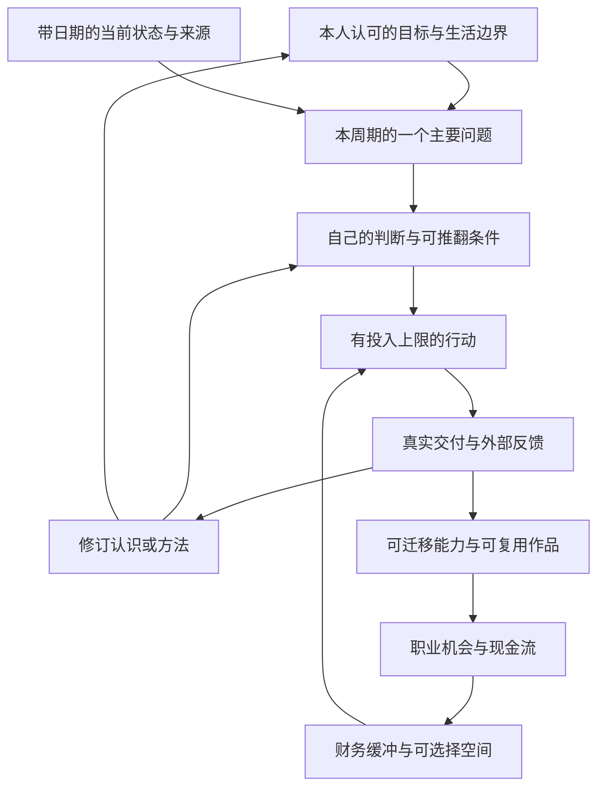

# 个人画像、运行模型与系统学习建议

版本：v0.3｜2026-11-05（北京时间）｜适用范围：个人成长、职业、学习、财务判断与知识系统。

**本人最新确认：** 任职国科制造（滨州）智能科技有限公司，公司在滨州、目前临沂出差；MES项目上线验收，负责全模块测试与实施。税前年薪26万元、包吃住，月消费约2000元，无负债；不加班、双休，平均每天看书3—4小时。持仓截图显示美元现金管理类理财参考市值16,545.28美元，口述16,500份未在截图展示；计划海外债券基金、股票限港美股；日常主要观看全哥价值投资。MES项目经理方向、宁波杭州偏好与美国移民长期规划保持不变。见[当前档案](知识库/15-个人档案/00-当前状态与长期方向.md)及[本次分析](07-本次补充分析与知识库更新.md)。下文解释与方案仍为分析建议。

**核心判断：材料呈现出一个以生活选择权为目标、偏好结构化建设与长期积累的人。当前最值得补强的是“依据—判断—行动—反馈”的连接，让职业、学习和资本积累形成可以检验的循环。**

本报告综合六份资料的123条主题提取、现有构建方案与运行规则，并回看职业、学习、目标、投资反思和AI协作的关键原文段落。六份资料都是AI整理的历史摘要；重复表述可能来自同一段历史对话，不能算六份独立证明。本报告可以作为当前的工作模型，个人经历、当前状态和解释仍由本人校准。

## 1. 先把画像的依据分开

| 层次 | 本次能说明什么 | 怎样使用 |
|---|---|---|
| 当前对话直接可见 | 本人确认当前任职、薪酬福利、地点、MES项目经理方向、长期城市偏好与美国移民规划 | 作为当前状态与意向；具体能力、实施路线与时间表分开记录 |
| 文档中的经历与偏好转述 | 软件测试与MES经历、储蓄和投资目标、阅读复盘、生活习惯变化等 | 引用来源，保留适用日期与待审状态 |
| 分析假设 | 自主性和安全感可能共同驱动选择；系统建设可能同时带来收益与维护负担 | 用实际行为和反馈修订 |
| 新提出的建议 | 90天主线、时间预算、运行面板与学习顺序 | 作为可采纳或调整的方案 |

审核表在首次123条基础上新增5条本人记录，当前128条中15条已有本人判断或适用性更正，113条尚未填写本人判断。本人标签与知识权重仍为空；分析建议与已确认意向分别保存。

## 2. 综合画像：用行为与约束描述自己

### 2.1 七个维度

| 维度 | 暂定画像 | 依据与限制 | 对系统的含义 |
|---|---|---|---|
| 主要追求 | 倾向于用财富、能力和较低固定成本，换取时间、城市与职业的选择空间 | R018、R041、R046；价值排序尚未确认 | 用“能否选择”检查目标，不只看资产数字 |
| 现实能力支点 | 本人确认当前从事MES测试，期望向MES项目经理发展 | R011、R015、R020与本人最新确认；具体能力仍缺作品与反馈 | 从测试经验出发，积累需求、范围、进度、沟通与验收方面的项目交付证据 |
| 学习取向 | 对跨学科解释、原始资料、自己的表述和复盘有兴趣 | R048—R051、R060、R117 | 围绕现实问题组织学习，给模型配上使用条件与反例 |
| 建设偏好 | 喜欢把零散经验组织成可持续积累的结构 | R059、R069及本轮请求；“建设动机强”不等于建设已经有效 | 系统需要保留积累感，也要定期检查维护是否值得 |
| 行为改变线索 | 材料记载过运动、减少烟酒等改变，以及写作和储蓄目标 | R052—R058；起始日期、执行频率与连续性没有统一核对 | 从实际可维持的节奏起步，分别记录不同习惯 |
| 决策中的张力 | 既重视下行保护，也希望较快完成财富和成长目标 | R036—R043、R070、R097—R098；不能据此确定风险承受能力 | 把期限、现金需求、最坏情景和等待选项写在决定之前 |
| 关系与生活 | 重视边界与独处，材料也记载过主动恢复亲友和同事连接 | R063—R067；当前支持网络仍不清楚 | 将休息、关系与生活体验放进时间预算，并保留其自身价值 |

**比较适合你的暂定自我描述：**

> 我希望通过职业能力、资本积累和持续学习，扩大生活选择权。我偏好结构清楚、依据可追溯的思考方式，也愿意修订判断。接下来要用具体交付与现实反馈，检验哪些认识和方法真正有效。

这段描述可以修改。它不要求你维持“极致理性”“超强自律”或某种固定人格形象。

### 2.2 值得保留的优势线索，以及尚缺的证据

1. **接触现实问题的机会。** 测试、制造流程与一线商业观察可以提供具体问题；能否形成优势，取决于能否解释问题、形成交付并经受反馈。接触一个行业不自动等于具备该行业的投资优势。
2. **把经验组织起来的意愿。** 资料收集、日记与复盘可以减少重复摸索；还需检查它们是否被真实决策调用，以及调用后改善了什么。
3. **对信息失真的警觉。** 材料反复记载对原文、证据和AI纠错的要求；下一步应把这种标准同时用于支持自己与反对自己的材料。
4. **长期建设的兴趣。** 储蓄、职业积累、阅读和建设类兴趣形成了共同主题；持续性应通过实际记录观察，不能从兴趣推导。

现有材料对目标、框架和自我解释的描述，远多于带日期的作品、真实现金流和可判定结果。**这首先是资料证据的缺口，不能据此断言你现实中缺少行动。** 后续补充应优先进入这三类证据，而非继续增加人物评价。

### 2.3 四个可以被推翻的画像假设

| 假设 | 支持线索 | 什么观察会要求修订 | 近期怎样检查 |
|---|---|---|---|
| H1：系统建设能促进应用 | 知识库、流程、日记与系统图兴趣 | 整理时间持续增加，实际检索和交付没有改善 | 记录两周：整理花了多久、哪条笔记进入了哪次行动 |
| H2：并行目标可能稀释投入 | 多类高频阅读、训练、写作与副业目标并存 | 现实时间充足，交付稳定，负荷可接受 | 先记录一周真实可支配时间，再决定项目数量 |
| H3：财富期限可能影响风险选择 | 百万目标与历史集中投入意向同现 | 每次选择都由资金用途和明确边界决定，期限不影响风险 | 检查最近一次财务决定的事前记录，而非事后解释 |
| H4：抽象理解到表达、应用之间仍有可改善空间 | 材料记录浅出表达、知行鸿沟等问题 | 你已有稳定、可独立完成的作品及外部反馈 | 选一个熟悉问题，脱离AI完成解释与交付，再对照反馈 |

这些假设用于检查系统设计，不是心理诊断或人格评分。若没有对应现象，应删除或改写假设。

## 3. 个人运行模型：五类积累、一个共同约束

### 3.1 五类需要维护的积累

| 积累 | 流入与流出 | 可观察的替代证据 | 常见误读 |
|---|---|---|---|
| 可支配财务资源 | 税后结余、投资净损益；必要支出、责任与损失 | 带日期的余额、负债和净现金流 | 把税前年包或受限账户余额当作可投资现金 |
| 可迁移职业能力 | 练习、交付、反馈与总结；遗忘、技能过时 | 能独立完成的任务、作品和复用记录 | 把任职年限和工具清单当成熟练度 |
| 可用知识与判断 | 自己能解释、应用并修订的认识；错误、失效与遗忘 | 原始依据、自己的解释、应用案例、修订记录 | 把收藏、AI文本和书单当作掌握 |
| 可用注意力与精力 | 休息、合理安排；工作、通勤、照料和切换消耗 | 一周实际可投入时段、负荷感受、未完成原因 | 假设所有空闲都能用于高强度学习 |
| 可信关系与支持 | 共同经历、沟通、互助；忽视与失信 | 遇到问题时可以交流和求助的真实连接 | 用人数推断关系质量，或只用工具价值评价关系 |

最后两项采用“积累”的分析视角，不意味着可以精确打分。关系、休息和生活体验也有独立价值。

**共同约束是时间、注意力与不可接受的代价。** 职业、投资、内容、阅读和系统维护会竞争同一段时间。一个领域的局部最优，可能让整体更难维持。

### 3.2 主运行链



图中是设计假设。能力不保证涨薪，现金流不保证投资盈利，反馈也可能要求放弃原方向。系统应保存这些中断，而非只记录顺利的循环。

### 3.3 四条值得观察的反馈回路

| 回路 | 机制假设 | 反馈延迟与边界 | 建议干预点 |
|---|---|---|---|
| R1 能力积累 | 聚焦练习 → 交付 → 反馈 → 改进后的能力 → 更合适的任务 | 交付可按周观察；能力迁移和职业回报需要更久，也受机会影响 | 把学习绑到一个具体作品，保留反馈与下一版 |
| R2 缓冲支持 | 稳定净流入 → 财务缓冲 → 减少被迫选择 → 更有余地积累能力 → 支持未来收入 | 按月记账，跨季度检查；工作稳定性和家庭责任可能变化 | 同时看现金余额、必要支出和未来用途 |
| R3 负荷放大 | 差距感上升 → 并行目标增加 → 单项投入下降 → 成果减少 → 差距感继续上升 | 可能在数周内显现；是否适用于你仍待观察 | 限制并行项目、缩小交付、保留未排满的时间 |
| B1 负荷调节 | 负荷上升 → 删减或缩小任务 → 负荷下降 | 调节需要允许删减的规则；临时加班也可能触发 | 连续两周难以完成时，先检查任务量和时间假设 |

R表示可能自我增强的循环，B表示抵消变化的调节循环；它们不是对你个人因果关系的实证结论。

### 3.4 不同层次使用不同的反馈速度

- **每周看行动：** 是否有交付、遇到什么阻碍、哪条认识被实际使用。
- **每月看状态：** 现金流、可投入时间、项目负荷与生活安排是否变化。
- **每季度看方向：** 职业积累是否可迁移，学习主线是否仍服务现实，哪些项目值得退出。
- **长期看结果：** 投资判断能力和人生选择空间需要更长时间观察；短期收益或单次成功不能完成验证。

## 4. 财务模型校准：先统一口径，再讨论路径

本人已确认税前年薪26万元、包吃住、月消费约2000元、当前无负债。最新截图补充一笔美元现金管理类理财参考市值16,545.28美元，口述16,500份未在图中展示；税后到账、完整资产、成本、流水、净值日期与资金用途仍待补。旧薪酬、本金及85%储蓄率仍按历史待审，不与新持仓重复计入。

建议先区分两个口径：

```text
本期可新增投入 = 本期税后实际到账 − 生活支出 − 其他责任支出 − 本期需新增的用途预留
期末投资账户价值 = 期初价值 + 账户净入金 + 本期投资净损益
```

用途预留需避免与已计入支出或已划出的资金重复扣除。把钱从一个自己的账户转到另一个账户，不是新增收入；工资入金不是投资收益。

### 一个需要纠正的旧结论

材料六P0120将“三年百万”表述为“高可行性（≥80%）”，但没有给出概率模型。即使接受它的本金与入金参数，确定性的复利算式也不能推出达成概率。

下面只做**条件算例**：初始12万元，每月末投入1.75万元（每年21万元），收益率按固定有效年率折算为月率，忽略税费、汇率和收入波动。它不是你的当前资产或收益预测。

| 固定年收益情景 | 34个月期末金额 | 36个月期末金额 |
|---|---:|---:|
| −10% | 60.6万元 | 63.0万元 |
| 0% | 71.5万元 | 75.0万元 |
| 5% | 77.5万元 | 81.6万元 |
| 8% | 81.2万元 | 85.8万元 |

计算式：月率 `r=(1+年率)^(1/12)-1`；期末金额 `P×(1+r)^n+C×((1+r)^n−1)/r`；月率为零时使用 `P+C×n`。固定收益路径只是简化算例，真实波动与入金时点会影响结果，表格也不是最坏情景界限。

若1999年9月出生的信息准确，“30岁前”的日期应落在2029年9月生日之前；从2026年11月起约为34个月，具体取决于生日和起算日。旧材料的2029年10月与这个条件不一致。

**对系统设计的影响：** 将本金、税后净流入、期限和收益假设分别保存。出现缺口时，比较提高可持续净流入、调整目标或延长期限等选项。比如在12万元本金上，额外1个百分点的年度收益约对应1200元；每月多结余1000元对应一年1.2万元。这个量级比较解释了为何积累初期值得关注职业与现金流，不能据此保证未来回报。

同时，新增入金不会消除原有投资损失；“估值打折”也不会锁定市场价格的跌幅。对应旧材料的R092—R094应继续保留在待核验层。

## 5. 系统构建：保留现有结构，增加一个运行入口

现有库已经有来源、观点、模型、问题、决策、行动、复盘和审核模块。继续使用即可。当前建议增加的是一页[个人系统运行面板](知识库/40-问题地图/个人系统运行面板-建议版.md)，把分散对象连接到当前问题。

### 5.1 一个主要项目，一个次要学习问题

**方向更新后的建议：以MES测试经验为基础，围绕向MES项目经理发展形成可展示的项目交付作品；以个人现金流校准和价值投资研究练习为并行学习线。** 下文90天安排保留为候选节奏，尚未成为本人承诺。

依据是：职业资料最具体，作品可能同时服务工作、求职和真实内容表达；财务口径是现有目标规划的重要缺口。这是初始排序，若当前岗位、兴趣或实际阻碍不同，应调整。

| 模块 | 最小运行方式 | 完成或扩展条件 |
|---|---|---|
| 方向 | 一页章程，写清本周期重视什么、接受什么代价 | 每季度或发生重大变化时复查 |
| 当前状态 | 只保存本次决定需要的职业、资金、时间与责任信息，并写日期 | 新变化追加版本；无关隐私不必收集 |
| 问题与项目 | 主项目1个，次要问题1个，其余放候选区 | 交付、暂停或退出后再替换 |
| 知识 | 只精加工会改变当前判断或反复使用的材料 | 其他材料保留来源即可 |
| 决策 | 小事用简版；重要选择使用现有决策模板 | 写明依据、代价、下一步和复查条件 |
| 反馈 | 行动后保存成果、反馈与规则改动 | 每次只改有依据的一两项 |

“1+1”是用于控制并行负荷的起始规则，不是普遍最优值。工具扩展也应由具体障碍触发：例如反复找不到已知来源，再考虑索引或自动化。

### 5.2 日常与周回顾

每天可用三行记录：今天推进的下一步；留下的成果或观察；明天接着做什么。普通小事无需完整填写模板。

每周用约20分钟回答：

1. 哪个问题发生了实际推进？成果在哪里？
2. 哪条认识被用了，结果如何？
3. 本周最大的阻碍是信息、技能、时间、外部条件，还是目标本身？
4. 下周继续、缩小、替换或停止什么？

把收入、学习时长、阅读字数和项目数都当作描述信息，避免用单一指标代表全部进步。休息和关系活动可以只安排时间，无需逐项绩效考核。

### 5.3 系统本身也接受检验

- 建议先按实际可支配时间安排约四分之三，余下作为波动空间；这是试行预算，不是研究结论。
- 若连续两周整理与维护明显挤占交付，先减少字段、分类或加工范围。
- 若记录没有被检索、用于判断或帮助复盘，可以降低处理深度；法律、财务凭据等保留需求另行考虑。
- 系统扩展前，先记录它要解决的具体障碍；完成一个真实循环后再决定是否需要新工具。

## 6. 学习建议：沿着问题、作品与反馈安排顺序

### 6.1 四条内容线，集中在同一批成果上

| 内容线 | 优先学习什么 | 怎样验收 | 当前控制范围 |
|---|---|---|---|
| MES业务与项目交付 | 从业务流程和测试验收出发，补充需求范围、里程碑、风险、沟通与变更管理 | 能解释一个完整流程，交付可使用的验收材料与项目推进说明 | 以现有测试经验为基础，逐步形成MES项目经理方向的能力证据 |
| 财务与投资基础 | 个人现金流口径；三张报表、附注、利润与现金的差异 | 能从原始披露找出数据、说明差异，并写出不知道什么 | 先完成事实还原，再做估值练习 |
| 系统与决策方法 | 存量流量、反馈、延迟、机会成本、替代解释与反证 | 每个模型至少有一个现实应用，以及一个失效情形 | 每次只引入当前问题用得上的模型 |
| 表达与AI协作 | 独立解释、清楚表达前提、核对引用、吸收反馈 | 离开AI能讲清问题，最终稿能逐项追溯依据 | 把表达嵌入职业和财务作品 |

材料中的广泛书单可以继续作为兴趣来源。当前主项目只保留少量直接相关材料；文学、历史和休闲阅读可以保留独立空间。

### 6.2 一个学习单元的完整过程

1. **先提问。** 写下本次要解决的问题，以及目前自己的解释。
2. **定向输入。** 阅读相关的一手材料、业务文档或书中对应章节。
3. **脱离材料回忆。** 用自己的话讲清关键关系，记录讲不出的部分。
4. **应用。** 产出流程图、分析说明、普通业务检查表或工作成果。
5. **反馈。** 对照原文或实际使用结果，修正错误；适合交流时，再向相关人员获取意见。
6. **隔一段时间再用。** 例如一周后尝试独立解释，并迁移到另一个相近问题。

这个流程是学习安排建议，不声称存在适合所有内容的学习方式效率排名。字数和时长可以记录，但验收应落在解释、应用与纠错上。

### 6.3 90天路线，按启动日计算

| 阶段 | 主要工作 | 看得见的产出 | 复查问题 |
|---|---|---|---|
| 第1—2周 | 校准本次项目需要的职业、财务、时间与目标口径；记录一周真实时间 | 当前状态简表；一个职业问题；项目投入上限 | 问题是否真实，时间假设是否成立？ |
| 第3—4周 | 选一个熟悉的MES/MOM业务流程，读实际业务资料，用系统模型梳理 | 一张流程图；关键状态、输入输出与验收条件说明 | 能否脱离AI解释，哪些环节仍不懂？ |
| 第5—8周 | 将流程理解转为验收与项目交付材料，说明范围、里程碑、风险与沟通事项，保留修改记录 | 一个完整作品及至少一轮使用反馈；可用时保留改进前后同口径观察 | 能否说清测试问题对项目交付的影响，哪些协调能力还需补充？ |
| 第9—10周 | 选择一家业务较熟悉的制造或工业软件企业，阅读一份年报与关键附注 | 一份利润、经营现金流、应收和存货关系的事实说明；列出未知项 | 每个关键数字是否有原文定位，解释是否超过证据？ |
| 第11—12周及余下日期 | 完成作品修改与阶段复盘，确定下周期保留的主线 | 作品第二版；一次阶段复盘；下一周期选择理由 | 有什么能力证据增加了，什么规则需要删改？ |

职业作品采用自己有权使用的材料；对外版本应按实际要求处理客户与公司信息。自建示例必须标为示例，不写成真实项目成果。这个安排不要求发布内容、投资交易或联系任何人。

### 6.4 时间预算的一个可调整起点

本人已说明当前不加班、双休，平均每天看书3—4小时。以下时间示例仅用于说明预算方法，不另行叠加到现有阅读时间，也不代表当前实际可用时间已经确认。

若每周确有6小时可支配时间，可先试行：职业项目3小时、财务学习1小时、系统方法与脱稿解释半小时、周回顾20分钟，其余约70分钟留作弹性。

若目前时间更少，优先保留一个职业交付和一次简短周回顾，其他部分顺延。不要把材料中的每天1小时、每天3小时、每日长日记与多项训练目标同时叠加为新标准。

## 7. AI协作：让它帮助检查判断

沿用资料中“准确、证据与反方”的要求，可以采用以下顺序：

1. 你先写问题、初步解释、关键依据，以及自己不确定的部分。
2. AI检查缺失前提、口径冲突、替代解释与反对证据，并区分事实、推断和建议。
3. 你回到关键来源，决定接受、修改或放弃哪项判断。
4. 实际行动后，把结果与事前判断放在一起复查。

适合AI协助的工作包括整理材料、定位冲突、比较方案与检查表达。当前状态、个人价值排序和最终选择仍需本人判断；外部财报和规则也须回到原始来源。

可以复用的检查提示：

> 下面是我对这个问题的初步解释。请逐项指出：哪些有来源支持，哪些只是推断；最重要的缺失前提是什么；有什么替代解释；什么观察会推翻结论；下一步最小的可执行行动是什么。保留不确定性，不增加未经提供的经历或数字。

## 8. 最先处理的五项校准

不必等完整知识库审核完再开始。先处理当前项目依赖的前提：

1. **当前职业与职责：** 公司、临沂出差、MES上线验收阶段及全模块测试实施已确认；下一步补实际问题、个人权限与交付反馈，对应R011、R014—R020、R124。
2. **当前财务口径：** 税前年薪26万元、包吃住、月消费约2000元、无负债已确认；截图补一笔理财参考市值16,545.28美元。税后到账、完整资产、成本、流水与资金用途仍待补，口述16,500份另行核对，对应R021—R026、R032、R035、R126。
3. **目标定义与期限：** 对应R036—R041，统一净资产或可投资资产等口径，以及具体截止日期。
4. **真实时间：** 当前不加班、双休，平均每天看书3—4小时已确认；进一步区分已有输入与可用于交付的时间，不把过去目标叠加为当前要求，对应R048、R125、R128。
5. **主线是否合适：** 结合当前工作和实际阻碍，接受或修改本报告的职业主线建议。

这些更正仍填写在原[真实性与标签审核表](知识库/80-审核与权重/01-真实性与标签审核.md)，避免产生第二份真实性主表。

## 9. 依据索引

| 本报告的判断或设计 | 关键条目与原文 |
|---|---|
| 职业能力与现金流主线 | [职业履历R009—R020](知识库/15-个人档案/02-职业履历与能力线索.md#r009) |
| 当前财务口径存在缺口 | [财务记录R021—R035](知识库/15-个人档案/03-财务记录与当前数据缺口.md#r021) |
| 自由、目标与风险之间的张力 | [目标与原则R036—R047](知识库/20-观点笔记/01-目标价值与原则候选.md#r036) |
| 学习输出、习惯与目标堆叠 | [学习生活R048—R062](知识库/20-观点笔记/02-学习生活与习惯记录.md#r048) |
| 建设偏好及其待验证条件 | [材料一P1185起](知识库/10-原始资料/SRC-20261105-001/段落转写.md#p1185) |
| 投资观察、意向和判断修订 | [材料一P0522起](知识库/10-原始资料/SRC-20261105-001/段落转写.md#p0522)；[R096—R099](知识库/25-投资研究/02-企业指数与历史数据待验.md#r096) |
| 关系连接与独处不能简单等同 | [关系记录R063—R074](知识库/20-观点笔记/03-关系感受与行为假设.md#r063)；[材料二P0238起](知识库/10-原始资料/SRC-20261105-002/段落转写.md#p0238) |
| 表达与内容项目仍需成果证据 | [内容副业R075—R084](知识库/20-观点笔记/04-内容副业与商业观察.md#r075) |
| 精确收益结论缺少概率模型 | [材料六P0120](知识库/10-原始资料/SRC-20261105-006/段落转写.md#p0120)；[R115](知识库/30-模型笔记/01-模型研究引文与测算待验.md#r115) |
| 入金与投资损失需要分开 | [投资方法R092—R094](知识库/25-投资研究/01-投资原则与方法候选.md#r092) |
| AI协作和数据治理 | [R119—R123](知识库/20-观点笔记/05-AI协作偏好与数据治理.md#r119)；[材料五P0129起](知识库/10-原始资料/SRC-20261105-005/段落转写.md#p0129) |
| 与既有系统的衔接 | [构建方案](01-构建方案.md)；[个人系统草案](知识库/40-问题地图/个人系统与持续成长草案.md)；[运行规则](知识库/00-运行规则.md) |

本报告中的解释与方案属于本地分析建议；已按本人直接回复回写明确确认的状态与意向，尚未评定知识权重。后续可继续补充带日期的状态、真实作品、使用反馈与判断修订。
