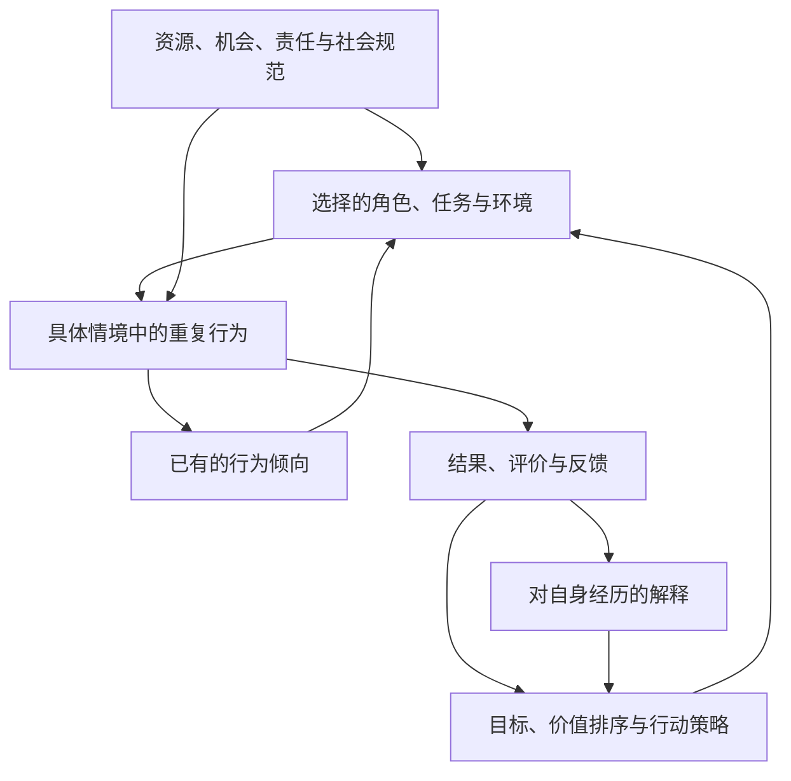

# 人格形成的多学科证据与个人分析

日期：2026-11-05（北京时间）。本次按本人确认的非生物方向开展，综合11项相关文献及现有个人资料。它是围绕问题选择文献的证据综述，尚未按预注册检索、双人筛选等程序完成覆盖全部文献的系统综述。

**核心判断：研究支持用“相对稳定的倾向、社会角色与资源条件、具体情境中的行为、目标与自我叙事”共同理解人格。对于你，现有证据较适合提出“重视选择权、偏好结构化理解、希望依据现实反馈修正自己”的工作假设；具体形成原因和完整人格维度仍需要独立证据。**

本报告将三个层次分开：文献中的群体规律；资料记录的个人事实与表达；对你提出的解释假设。群体研究能够支持分析框架，不能据此计算你的家庭、工作或创业经历各贡献了多少人格，也不能从聊天推算人格百分位。

## 1. 怎样使用“人格”这个概念

| 分析对象 | 回答的问题 | 适合的证据 | 你目前的资料情况 |
|---|---|---|---|
| 特质 | 一段较长时间、多个情境下，通常怎样行动和体验？ | 经过验证的量表、跨情境行为、必要时的他人评价 | 现有文字提供线索，尚无规范测量与跨情境对照 |
| 当前状态 | 最近一个阶段怎样表现？ | 带日期的具体经历、工作负荷与活动记录 | 历史摘要混有不同阶段，需要分别定位 |
| 目标、价值与策略 | 希望获得什么，愿意付出哪些代价，采用什么办法？ | 本人表达、实际选择与取舍 | 职业和长期地点方向已有较新的确认记录 |
| 社会条件与角色 | 资源、机会、评价与责任怎样影响选择？ | 职位、实际任务、可用支持、资金与时间约束 | 当前职业较清楚，其他条件仍有缺口 |
| 自我叙事 | 怎样解释自己的过去与未来？ | 本人原话、不同时间的叙述及其变化 | 多数旧资料由AI整理，需回到原话或由本人更正 |

BFI-2的开发研究区分五个宽泛特质维度和15个较具体的侧面，并检验自评与他评相关表现。[E10] 因此，“喜欢计划”只能提供部分条理性线索，“喜欢研究”也只涉及部分求知兴趣；这些表现不足以覆盖整个尽责性或开放性。

## 2. 可以核对的研究与统计

下表中的样本数和结果来自已核对的文献摘要、公开全文或出版方元数据。完整访问层次见文末。`k`保留论文报告的研究或样本单位，`N`为该分析报告的样本数；不同分析可能使用重叠样本。

| 研究与视角 | 研究设计、规模 | 已核到的结果 | 对本次分析的支持与限制 |
|---|---|---|---|
| **E1 Bleidorn等，2022：人格发展** | 纵向元分析；相对排序稳定性部分`k=189，N=178,503`；平均水平变化部分`k=276，N=242,542` | 人格既稳定又可变；相对排序稳定性在早期增长、青年期趋于平台，25岁后进一步增加的证据较少；同时仍存在平均水平变化 | 支持同时考察连续性与改变。相对排序稳定性的平台，不等于个体此后停止变化；两部分样本不可相加当作独立人数 |
| **E2 Specht等，2011：社会经历与人生角色** | 德国成人纵向研究，`N=14,718` | 人格可以预测部分人生事件的发生，经历这些事件后也可观察到人格变化；将事件简单归为“好／坏”会遗漏或过度概括关系 | 支持检查“选择环境”与“环境中的变化”两个方向。观察性纵向结果仍不足以确定你的某段经历造成了什么变化 |
| **E3 Fleeson，2001：情境与行为** | 3项日常经验取样研究，各持续约2—3周 | 同一个人的行为随情境有较大波动，行为分布的中心倾向又呈现稳定个体差异 | 支持把“某次独处、某次强硬、某周疲惫”与跨情境倾向分开。短期经验取样不能证明长期形成原因 |
| **E4 Wilmot与Ones，2019：组织行为** | 二阶定量综述，覆盖92篇元分析、175类职业变量 | 尽责性与职业相关表现存在广泛的有利关系；职业复杂程度会调节其与绩效的关系，高复杂职业中的关系相对较弱 | 支持关注可靠履行、坚持和具体任务环境。综述覆盖的变量并非同一个“成功”指标，也不能据此认定你的尽责性水平 |
| **E5 Poropat，2009：人格与教育表现** | 元分析，不同分析的累计样本规模最高超过70,000 | 尽责性、开放性、宜人性与学业表现存在显著相关；尽责性的相关在所检验分析中大体独立于认知能力；学段与年龄存在调节作用 | 支持把学习行为与能力、情境共同考察。学业相关不能直接换算为职场表现或你个人的收益 |
| **E6 Credé等，2017：毅力概念检验** | 88个独立样本，`N=66,807`，584个效应量 | “grit”的高阶结构未获确认，与尽责性高度相关；努力坚持侧面比兴趣一致性侧面具有更强的效标关联 | 支持分别考察坚持、调整方向和实际效果；不能由“长期坚持”直接推出成功，也不能把改变方向视为人格失败 |
| **E7 Sisk等，2018：成长心态** | 相关性元分析`k=273，N=365,915`；干预元分析`k=43，N=57,155` | 两部分总体效应均较弱；部分结果提示低社会经济地位或学业风险学生可能受益 | 支持保留心态的作用，同时检查资源、教学与行为。该文没有证明仅靠信念能够普遍大幅改变成绩 |
| **E8 Yeager等，2019：教育现场实验** | 美国65所公立高中，12,490名九年级学生个体随机分组；主要成绩分析针对其中6,320名原先成绩较低的学生 | 该预先界定子组的核心课程GPA平均提高0.10分（0—4.3分量尺），95%置信区间`[0.04,0.16]`，标准化效应`d=0.11`；效果随学校情境而异 | 随机分组支持该干预对目标子组平均成绩的因果解释。学校同伴规范是测量变量，其调节结果不等于规范本身经过随机操纵；也不能直接推论你的成人职业结果 |

上述文献可通过DOI核对：

- [E1：人格稳定与变化元分析](https://doi.org/10.1037/bul0000365)
- [E2：人生事件与人格纵向研究](https://doi.org/10.1037/a0024950)
- [E3：人格特质与日常状态](https://doi.org/10.1037/0022-3514.80.6.1011)
- [E4：工作中的尽责性综述](https://doi.org/10.1073/pnas.1908430116)
- [E5：人格与学业表现元分析](https://doi.org/10.1037/a0014996)
- [E6：毅力元分析](https://doi.org/10.1037/pspp0000102)
- [E7：成长心态两项元分析](https://doi.org/10.1177/0956797617739704)
- [E8：教育现场随机实验](https://doi.org/10.1038/s41586-019-1466-y)

### 这些数字怎样解释

1. **大样本主要改善估计的精确性。** 样本大不等于效应大，也不能消除设计、测量和选择偏差。
2. **相关与改变是不同的问题。** 尽责性与表现相关，不能直接证明“提高量表分数就会按同样幅度改善表现”。
3. **效应量有明确单位。** E8的`d=0.11`表示约0.11个标准差，不能写成“成绩提高11%”；0.10是GPA分值变化，论文使用的成绩范围也需保留。
4. **分组平均值与个体结果分开。** E8的主要GPA结论属于预先界定的较低成绩子组，不能写成所有12,490名学生都提高了同样幅度。
5. **研究覆盖与适用人群分开。** 德国成人、美国学生及以西方样本为主的文献，为中国成年职场个体提供分析线索，尚不能直接给出个人常模或因果解释。

## 3. 多学科怎样解释人格形成

### 3.1 人格心理学：稳定倾向与情境变化同时存在

E1支持人格在较长时期具有连续性，也发生变化；E3进一步表明，一个人在不同情境中会表现出很不一样的行为。两者可以同时成立。

因此，分析你时应分别问：

- 你是否在多个情境中都倾向先整理结构、查找依据？
- 这种倾向只出现在投资和学习，还是也出现在工作协作与日常安排？
- 近期独处更多，是稳定的社交偏好，还是出差、项目负荷、兴趣变化等条件下的安排？

这些问题比直接认定某种固定人格类型，更能明确还缺什么证据。

### 3.2 社会学与社会心理学：资源和机会改变选择条件

Manstead（2018）的社会阶层研究综述强调，物质条件、社会身份、学校及工作场所的主流规范，会影响人怎样理解自己和环境，以及能够获得哪些机会。[E9] 这是一篇叙述性综述，没有可以概括所有这些关系的单一总体效应量。

对你的分析可检查：流动成本、工作机会、可用支持和实际责任，是否影响了对收入、安全和城市的排序。资料中的家庭背景与早期经历目前仍有待审部分，不能直接推出固定的风险偏好、价值观或人生上限。

社会条件也不会替个人选择提供唯一解释。同样的资源条件下，人仍可能有不同目标；同样的计划，也可能因机会不同而产生不同结果。

### 3.3 组织行为：人格影响角色选择，角色也提供重复练习

E2支持同时检查选择和社会化关系；E4表明职业表现中的人格关系会随任务环境而变化。综合起来，一个合适的工作假设是：

> 原有倾向影响选择哪些工作与任务；工作中的要求、反馈和重复行为又可能影响后续策略与表现。

你当前从事MES测试，并希望向MES项目经理发展。测试工作中的需求理解、证据检查与结果对照，可以成为职业方法的来源；但“从事测试”本身不能证明高尽责性，也不能证明工作造成了某种人格。

向项目经理发展的实际任务，可以帮助观察协调、取舍、沟通和交付行为。需要明确职责和反馈，再检验哪些能力已形成、哪些仍需练习。

### 3.4 教育学：信念、学习机会和实际行动共同考察

E7与E8共同支持一个有边界的结论：成长心态可能发挥作用，总体效果及适用条件需要具体检验。积极信念、具体学习策略、教学和环境支持，应分别记录。

对你的系统，学习安排宜连接到：一个明确任务、合适的资料、自己的解释、实际使用和反馈。阅读字数、坚持时长可以描述投入，作品及应用结果则提供另一类证据。

这里从学校研究迁移到个人学习系统，属于设计建议，尚未证明同样的效应会在你身上发生。

### 3.5 叙事视角：自我解释会发展，也应允许修订

McAdams与McLean（2013）将叙事认同描述为不断发展的内在生命故事，它连接对过去的重构和对未来的想象。[E11] 本报告只采用这一概念层面，未用它对你作任何结果预测。

你旧资料里的“系统重建者”“人生导演”等说法，可能表达了自我理解，也可能包含AI的整理和修辞。应分别保留：发生过的事件、本人当时的理解、后来怎样重新解释。这样既能保留意义，也能减少为了维护某种形象而忽略反例的可能。

## 4. 综合形成模型

下面是依据上述文献组织的分析框架，箭头表示待检验关系，没有为各因素赋予个人因果权重。

其中，“重复行为→较长期倾向”的变化需要较长时间和适当测量支持；一次成功、中断或决定，不能完成验证。当前状态、能力进步与人格变化也应分别记录。

## 5. 将模型用于你：哪些能说，哪些还要检验

### 5.1 当前依据的层次

- **当前对话直接可见：** 你明确要求多学科视角、实际研究与权威统计支持，并限定非生物研究范围。这能说明本次任务中的证据要求。
- **知识库中的较新本人确认记录：** 现从事MES测试，职业意向为MES项目经理；长期工作地倾向宁波、杭州，有美国移民规划，并行研究价值投资。来源为[当前状态与长期方向](知识库/15-个人档案/00-当前状态与长期方向.md)及其本人确认原文。
- **旧摘要中的线索：** 阅读、日记、运动、生活习惯调整、创业经历与财务目标等，仍需按原审核状态使用。多份摘要重复，不增加独立证据数量。

### 5.2 六项暂定解释

| 暂定解释 | 个人资料依据 | 可以连接的研究视角 | 替代解释与检验方向 |
|---|---|---|---|
| 你在追求更大的职业和生活选择空间 | 较新职业、城市与长期规划确认；R041、R046的历史表达 | 目标与角色选择、社会机会 | 也可能是当前阶段的现实安排；需要比较实际取舍，而非只读目标文本 |
| 你偏好结构化理解和依据检查 | 本轮要求研究统计；R050、R060、R119的历史线索 | 特质的部分侧面、职业任务与反馈 | 可能是工作方法或当前任务要求；观察它是否跨情境出现 |
| 安全、积累和较低固定成本可能影响选择 | R031—R043及生活选择记录 | 资源条件、经历与策略调整 | 不能直接归因于家庭或创业经历；需有变化前后的记录与其他解释 |
| 你可能用“建设、修订”组织自我理解 | 知识库建设与旧资料的相关表述 | 叙事认同、目标与行动策略 | 部分说法可能由AI强化；需要本人确认，并允许与实际行为不一致 |
| 长期积累兴趣可能存在，持续性仍需证据 | R048—R061、R069中的兴趣和计划 | 尽责性侧面、毅力概念区分 | 兴趣、计划、实际完成和有效结果分别记录；允许合理改变方向 |
| 当前社交表现可能受角色和情境影响 | R063—R068的历史变化 | 日常状态差异、社会情境 | 独处不直接等于外向性降低；需要比较熟人、工作协作、休闲等情境 |

**据此，目前较稳妥的描述是：你明确希望用有依据的理解帮助职业与长期选择，并倾向把经验组织成可修订的结构。材料提供了建设与积累偏好的线索，尚不足以完成稳定人格评估或确定形成原因。**

### 5.3 大五维度目前能解释到哪一步

| 维度 | 可以保留的线索 | 当前不能确定的部分 |
|---|---|---|
| 开放性 | 求知兴趣、多学科问题与模型兴趣 | 其他侧面和整体水平，尤其不能从研究兴趣推算认知能力 |
| 尽责性 | 对条理、计划、检查和长期积累的重视 | 多情境下的可靠履行、执行持续性和整体水平 |
| 外向性 | 材料中的独处与选择性社交变化 | 社交活力、主导性等侧面，以及长期平均倾向 |
| 宜人性 | 资料中对真实、边界与商业伦理的关注 | 这些价值表达与合作、信任、同情等日常行为的关系 |
| 负性情绪倾向 | 旧材料记录过阶段性疲惫、怀疑与压力感受 | 是否跨时间、跨情境稳定；不能从财务谨慎或一次情绪推定 |

本次不根据聊天给这五项打分。若以后使用量表，应选择有相应语言验证资料、适用人群和计分说明的版本，并结合具体行为解释结果。[E10]

## 6. 怎样把分析转为更有依据的个人系统

### 6.1 增加证据的优先顺序

1. **先恢复时间线。** 对几段重要经历，记录发生日期、当时目标、实际选择和可找到的原始记录。将“当时怎样想”与“现在怎样解释”分开。
2. **再比较情境。** 例如同样是表达意见，在熟悉业务、跨部门协作和陌生社交中，行为是否不同；记录当时任务、责任与可选做法。
3. **补充反例。** 每项自我描述都找一个不符合的场景，检查是否需要缩小适用范围。
4. **最后更新解释。** 新材料支持的是状态、技能、策略，还是较长期倾向？不要把所有改善统一写成人格升级。

无需把日常生活全部纳入记录。可以复用已有[运行面板](知识库/40-问题地图/个人系统运行面板-建议版.md)，只保存对当前问题有用的内容。

### 6.2 一个四周的轻量校准建议

| 周期 | 要做什么 | 产生什么证据 |
|---|---|---|
| 第1周 | 选一个工作问题和一项自我描述，核对相关时间线 | 事实、本人原话、后来的解释分别保存 |
| 第2周 | 记录几次不同情境下的具体选择 | 情境、目标、可选做法、实际行为与结果 |
| 第3周 | 寻找反例、替代解释；适合时参考已有工作反馈 | 缩小过强描述，列出尚不能解释的部分 |
| 第4周 | 复查哪个解释更有依据，决定保留或调整一个行动规则 | 一次有出处的认识修订 |

这是个人整理与观察建议，四周记录不足以证明长期人格因果关系，也不需要对每件事打分。

### 6.3 与MES项目经理方向连接

以一个本人有权处理的真实任务为单位，记录：

- 业务目标和相关角色分别关心什么；
- 有哪些需求、进度、资源与验收之间的取舍；
- 自己怎样解释问题、协调分歧和推进交付；
- 哪种做法得到实际支持，哪种需要改变。

这些记录可以同时服务职业作品、反馈与自我认识。它们比“我适不适合管理”的笼统结论提供更具体的判断依据。最终仍需结合实际职责、机会和他人使用成果的情况。

### 6.4 对既有系统的三项调整建议

- **画像增加适用情境。** 从“我是怎样的人”细化到“在什么情境下，通常怎样做，有哪些例外”。
- **形成解释增加来源层次。** 把本人确认、历史摘要、外部研究与本次推断分开链接。
- **复盘增加结构条件。** 除个人努力外，检查任务要求、信息、资源、反馈、机会与外部变化。

## 7. 来源、核验深度与访问限制

本次通过Crossref核对书目信息，通过OpenAlex所收录摘要补足部分研究内容；能够取得的公开全文另行检查。索引摘要可能含截断、修订说明或公式格式问题，涉及这些问题的数值未用于正文。没有逐表重新计算元分析，也没有声称阅读全文中的每个引用研究。

| 编号 | 文献 | 本次核对层次 |
|---|---|---|
| E1 | Bleidorn, W., et al. (2022). *Personality stability and change: A meta-analysis of longitudinal studies*. Psychological Bulletin. [DOI](https://doi.org/10.1037/bul0000365) | Crossref书目＋OpenAlex收录摘要；规模、两种稳定／变化概念及总体结论 |
| E2 | Specht, J., Egloff, B., & Schmukle, S. C. (2011). *Stability and change of personality across the life course…* Journal of Personality and Social Psychology, 101, 862–882. [DOI](https://doi.org/10.1037/a0024950) | 书目＋索引摘要＋RePEc公开条目；未逐项复算模型 |
| E3 | Fleeson, W. (2001). *Toward a structure- and process-integrated view of personality: Traits as density distributions of states*. Journal of Personality and Social Psychology, 80, 1011–1027. [DOI](https://doi.org/10.1037/0022-3514.80.6.1011) | 书目＋索引摘要；3项研究、2—3周及状态分布结论 |
| E4 | Wilmot, M. P., & Ones, D. S. (2019). *A century of research on conscientiousness at work*. PNAS, 116, 23004–23010. [DOI](https://doi.org/10.1073/pnas.1908430116) | 出版方经Crossref提供的摘要＋索引摘要；92篇元分析、175类变量与复杂度调节。公式存在呈现问题，未引用精确总体相关系数 |
| E5 | Poropat, A. E. (2009). *A meta-analysis of the five-factor model of personality and academic performance*. Psychological Bulletin, 135, 322–338. [DOI](https://doi.org/10.1037/a0014996) | 书目＋索引摘要；保留“最高超过70,000”的口径，未填入未核到的分维度系数 |
| E6 | Credé, M., Tynan, M. C., & Harms, P. D. (2017). *Much ado about grit: A meta-analytic synthesis of the grit literature*. Journal of Personality and Social Psychology, 113, 492–511. [DOI](https://doi.org/10.1037/pspp0000102) | 书目＋索引摘要；样本、效应量数与构念结论 |
| E7 | Sisk, V. F., et al. (2018). *To What Extent and Under Which Circumstances Are Growth Mind-Sets Important to Academic Achievement? Two Meta-Analyses*. Psychological Science, 29, 549–571. [DOI](https://doi.org/10.1177/0956797617739704) | 出版方经Crossref提供的摘要＋索引摘要；两组规模与总体较弱的结论，未引用未核到的精确汇总系数 |
| E8 | Yeager, D. S., et al. (2019). *A national experiment reveals where a growth mindset improves achievement*. Nature, 573, 364–369. [全文](https://www.nature.com/articles/s41586-019-1466-y) | 出版方公开全文；重点核对Abstract、Participants、主要GPA结果、情境调节与其因果限制 |
| E9 | Manstead, A. S. R. (2018). *The psychology of social class: How socioeconomic status impacts thought, feelings, and behaviour*. British Journal of Social Psychology, 57, 267–291. [DOI](https://doi.org/10.1111/bjso.12251) | 摘要＋公开全文XML的相关段落；作为社会条件视角，不提供统一因果效应或个人结论 |
| E10 | Soto, C. J., & John, O. P. (2017). *The next Big Five Inventory (BFI-2)…* Journal of Personality and Social Psychology, 113, 117–143. [DOI](https://doi.org/10.1037/pspp0000096) | 正文献书目＋索引摘要；区分原文与另行发表的勘误，采用3项开发验证研究和15侧面的结构信息 |
| E11 | McAdams, D. P., & McLean, K. C. (2013). *Narrative Identity*. Current Directions in Psychological Science, 22, 233–238. [DOI](https://doi.org/10.1177/0963721413475622) | 书目＋摘要；只用于叙事认同的概念，不作为个人形成原因或结果的证明 |

部分出版方页面返回403；部分公开镜像仅返回访问验证页，未将这些页面视为已读论文。成功读取的内容、元数据、失败记录和检索候选保存在`_research/personality_nonbio_20261105`。其中的候选文献不都进入本报告，失败页面也没有用于支持结论。

### 个人资料依据

- [当前状态与长期方向](知识库/15-个人档案/00-当前状态与长期方向.md)及[本人确认原文](知识库/10-原始资料/SRC-USER-20261105-001/本人确认原文.md)。
- [目标价值与原则候选](知识库/20-观点笔记/01-目标价值与原则候选.md)、[学习生活与习惯记录](知识库/20-观点笔记/02-学习生活与习惯记录.md)。
- [关系感受与行为假设](知识库/20-观点笔记/03-关系感受与行为假设.md)、[AI协作偏好与数据治理](知识库/20-观点笔记/05-AI协作偏好与数据治理.md)。
- [原画像与系统建议](05-个人画像与系统学习建议.md)、[唯一审核表](知识库/80-审核与权重/01-真实性与标签审核.md)。

本轮未修改个人真实性审核、标签或知识权重。文献支持范围与个体解释分别保留，后续以新证据修订。
